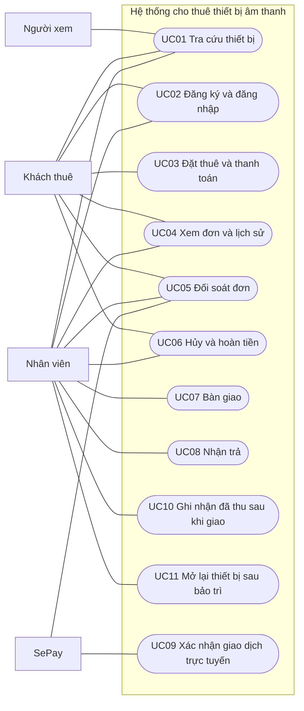
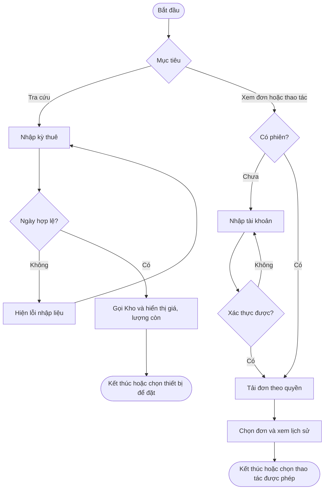
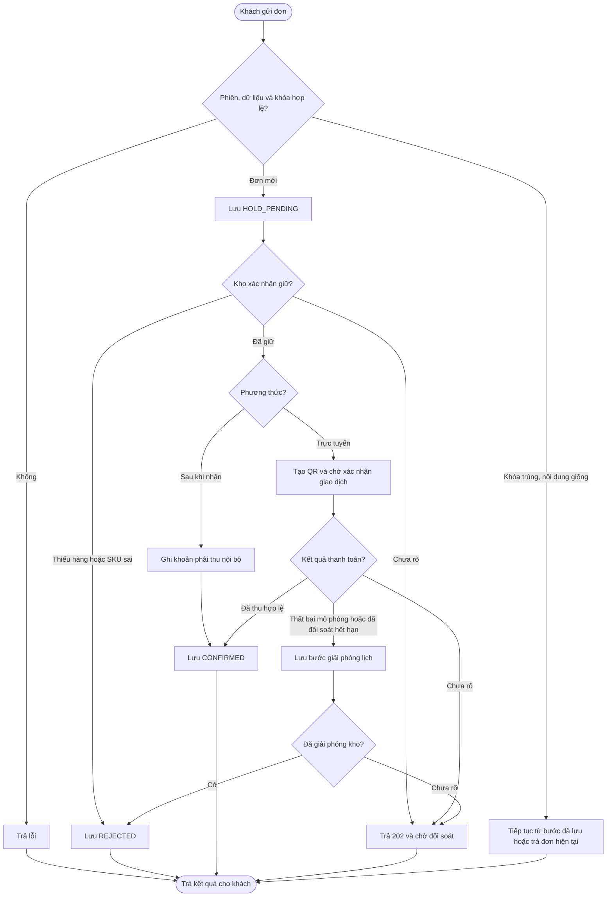
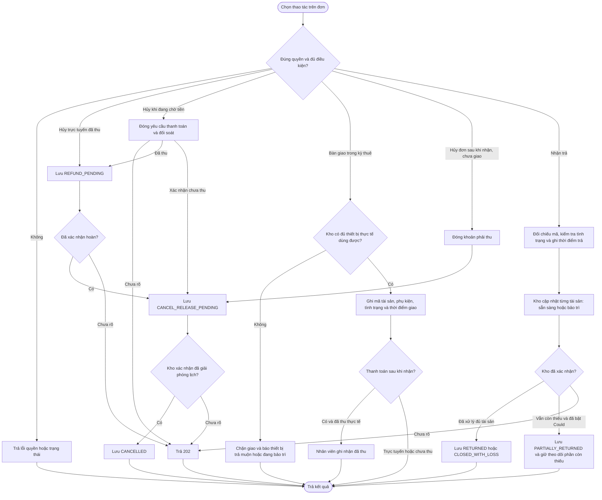
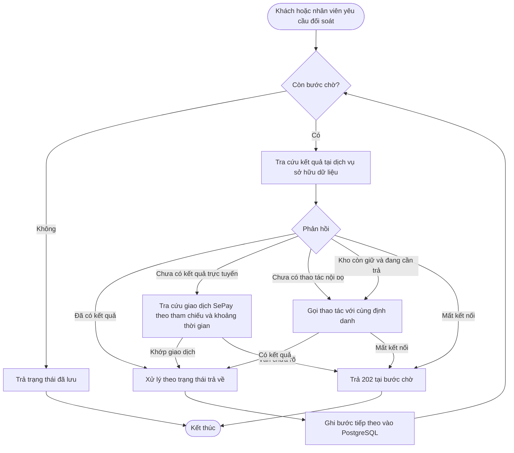

# Phân tích hệ thống cho thuê thiết bị âm thanh

## 1. Phạm vi đề xuất

Khách đặt lịch sử dụng một bộ thiết bị cho sự kiện, ví dụ hai loa, một bàn trộn âm thanh và hai micro. Khách chọn **thời điểm nhận và hạn trả** trước khi tra thiết bị khả dụng. Hệ thống giữ từng thiết bị trong kỳ thuê, ghi thiết bị thực tế đã giao, theo dõi thiết bị quá hạn và kiểm tra tình trạng khi nhận lại. Thiết bị đã bàn giao chỉ sẵn sàng cho lượt tiếp theo sau khi khách trả và nhân viên kiểm tra đạt.

Tiền thuê tính theo kỳ đặt. Khách chọn chuyển khoản trực tuyến trước qua SePay hoặc thanh toán sau khi nhận thiết bị để nhân viên ghi nhận thực thu. Trạng thái thuê và trạng thái tiền được theo dõi riêng. Thiết bị vẫn phải được nhận trả và kiểm tra dù khoản thuê đã được thanh toán trước.

Phạm vi đề xuất cho hai người gồm một điểm nhận/trả, thuê theo bộ tự chọn, bàn giao một lần và hoàn trả đủ bộ, theo dõi quá hạn và tạm khóa thiết bị hỏng. Hoàn trả từng phần, báo mất và thay tài sản thuộc Could. Phiếu riêng của đề tài sẽ quyết định có bổ sung tiền cọc, phụ phí trả trễ/hư hỏng, gia hạn, giao tận nơi hay không. Bản thiết kế cơ sở ghi nhận sự cố và tình trạng thiết bị để nhân viên xử lý.

Khách có thể tự đăng ký tài khoản khách thuê. Tài khoản nhân viên được cấp qua quy trình quản trị riêng. Danh mục có thể tra cứu công khai. Khi đặt thuê, hệ thống yêu cầu phiên hợp lệ. Môi trường thử dùng bộ dữ liệu và thông tin xác thực riêng.

## 2. Tác nhân

| Tác nhân | Mục tiêu và quyền |
|---|---|
| Người xem chưa đăng nhập | Xem danh mục, giá và số lượng khả dụng theo kỳ thuê. |
| Khách thuê | Đăng nhập, tạo đơn, xem và đối soát đơn của mình, hủy trước khi bàn giao. |
| Nhân viên | Xem lịch nhận/trả và các lượt quá hạn, bàn giao theo mã tài sản, kiểm tra tình trạng khi nhận lại, đưa thiết bị đã sửa về trạng thái sẵn sàng, ghi nhận thực thu. |
| SePay | Hệ thống ngoài gửi thông báo giao dịch và cung cấp dữ liệu tra cứu cho nhánh thanh toán trực tuyến. |

Ranh giới use case là toàn bộ ứng dụng. Kho và Thanh toán là dịch vụ nội bộ. Bộ mô phỏng thuộc dịch vụ Thanh toán và dùng cho kiểm thử có kiểm soát.

## 3. Đặc tả từng use case

| Node và tác nhân | Điều kiện và đầu vào | Luồng chính | Nhánh và hậu điều kiện |
|---|---|---|---|
| **UC01 Tra cứu thiết bị** · Người xem, khách, nhân viên | Thời điểm nhận và hạn trả hợp lệ. | Kho đếm theo loại thiết bị các tài sản đủ điều kiện trong toàn bộ kỳ. Trả số lượng dự kiến khả dụng và đơn giá thuê. | Kết quả tra cứu chưa giữ lịch. Lịch tương lai có thể bị ảnh hưởng nếu lượt trước trả muộn hoặc trả về thiết bị hỏng. |
| **UC02 Đăng ký và đăng nhập** · Khách, nhân viên | Khách có thể đăng ký tên và mật khẩu. Nhân viên đăng nhập bằng tài khoản được cấp. | Đăng ký chỉ tạo tài khoản CUSTOMER. Khi đăng nhập, Thuê xác thực, cấp cookie HttpOnly có hạn 30 phút và trả vai trò. | Sai tài khoản trả `401`. Đăng xuất thu hồi phiên tại Thuê. Luồng đổi mật khẩu tạm thuộc giai đoạn cấp tài khoản nhân viên. |
| **UC03 Đặt thuê và chọn phương thức** · Khách | Phiên khách, kỳ thuê, danh sách thiết bị và số lượng, `ONLINE` hoặc `PAY_ON_RECEIPT`, `Idempotency-Key`. | Kho phân bổ đủ tài sản cho toàn kỳ và chốt giá. Với `ONLINE`, tạo mã/QR rồi chờ xác nhận tiền. Với `PAY_ON_RECEIPT`, lưu khoản phải thu và xác nhận lịch thuê. | Thiếu thiết bị trong kỳ → từ chối toàn bộ yêu cầu. Cùng khóa và nội dung → trả lại cùng đơn. Cùng khóa khác nội dung → `409`. |
| **UC04 Xem lịch thuê và lịch sử** · Khách, nhân viên | Phiên còn hiệu lực, mã đơn khi mở chi tiết. | Khách xem lịch của mình, thời điểm nhận, hạn trả và tình trạng thanh toán. Nhân viên lọc lịch nhận/trả, xem lượt quá hạn và biên bản. | Đơn không tồn tại hoặc thuộc khách khác trả `404`. Quá hạn được tính từ hạn trả và tình trạng thiết bị còn ngoài kho. |
| **UC05 Đối soát đơn** · Khách, nhân viên | Có quyền xem đơn. | Thuê đọc bước đã lưu và tra cứu dịch vụ chịu trách nhiệm. Với khoản trực tuyến đang chờ, Thanh toán có thể tra cứu giao dịch SePay và ghép theo mã. | Chưa xác định được → giữ trạng thái chờ. Đơn đã kết thúc → trả trạng thái hiện tại. Khởi động lại vẫn đọc được bước chờ. |
| **UC06 Hủy và hoàn tiền** · Khách, nhân viên | Chủ đơn hoặc nhân viên, đơn chưa bàn giao, gồm đơn trực tuyến đang chờ tiền. | Trực tuyến đang chờ: đóng QR và đối soát. Trực tuyến đã thu: tạo yêu cầu hoàn và xác nhận đã hoàn trước khi giải phóng giữ. Với phương thức thanh toán khi nhận, nếu chưa thu thì đóng khoản phải thu rồi giải phóng giữ. | MVP hoàn toàn bộ tiền đã thu và không tính phí khi hủy trước bàn giao, kể cả sát giờ nhận. Chưa biết kết quả thu thì chờ đối soát. Đã bàn giao thì từ chối hủy. Với tiền thật, nhân viên hoàn thủ công và ghi tham chiếu. |
| **UC07 Bàn giao** · Nhân viên | Lịch đã xác nhận, từ giờ hẹn đến trước hạn đến nhận. Với trực tuyến, khoản thuê đã được xác nhận. | Kho kiểm tra tài sản thực tế có mặt và dùng được. Nhân viên kiểm tra chức năng cơ bản, ghi mã tài sản, phụ kiện đi kèm và tình trạng lúc giao. Kho đánh dấu thiết bị `OUT_ON_RENT`; Thuê ghi `HANDED_OVER` và thời điểm giao. | Thiết bị còn ở lượt thuê trước hoặc đang bảo trì → chặn toàn bộ bàn giao. Khi bật Could, nhân viên chọn tài sản cùng loại và Kho kiểm tra lại. |
| **UC08 Nhận trả và kiểm tra** · Nhân viên | Đơn đã bàn giao hoặc trả một phần, kể cả khi đã quá hạn. | Đối chiếu mã tài sản và phụ kiện lúc giao. Ghi thời điểm trả thực tế, tình trạng, thiếu phụ kiện nếu có. Kho đưa thiết bị đạt kiểm tra về `AVAILABLE`, giữ thiết bị hỏng hoặc thiếu phụ kiện ở `MAINTENANCE`. Thuê ghi trạng thái hoàn trả theo số thiết bị còn thiếu và thời lượng quá hạn nếu có. | Chưa đủ và chưa bật Could → `409 INCOMPLETE_RETURN`, giữ lượt thuê đang mở. Khi bật Could, chưa nhận đủ → PARTIALLY_RETURNED, cập nhật ngay tài sản đã trả. Xác nhận mất → LOST ở Kho và CLOSED_WITH_LOSS khi không còn tài sản chờ. Kho gián đoạn → chờ đối soát. Gửi lặp cùng biên bản không cập nhật kho lần hai. |
| **UC09 Xác nhận giao dịch trực tuyến** · SePay | Webhook đã xác thực, giao dịch tiền vào khớp mã, số tiền và tài khoản nhận. | Thanh toán lưu mã giao dịch ngoài, ghi `PAID` một lần. Thuê đọc trạng thái mỗi 5 giây để xác nhận đơn. | Sự kiện lặp trả kết quả đã ghi. Sai số tiền, không ghép được hoặc giao dịch đến sau khi đơn đã đóng → chuyển đối soát thủ công. |
| **UC10 Ghi nhận đã thu sau khi giao** · Nhân viên | Đơn đã bàn giao, kể cả đã hoàn trả hoặc đóng vì mất tài sản, chọn thanh toán sau khi nhận, khoản phải thu còn mở. | Nhân viên xác nhận đã thực thu. Thuê kiểm tra quyền và gọi Thanh toán lưu người ghi nhận, thời điểm và số tiền. | Thao tác trước bàn giao bị từ chối. Gửi lặp trả bản ghi cũ. Không tạo QR và không gọi SePay. |
| **UC11 Mở lại thiết bị sau bảo trì** · Nhân viên | Tài sản `MAINTENANCE`, đã kiểm tra lại chức năng và phụ kiện. | Kho lưu người kiểm tra, thời điểm và kết quả, rồi chuyển thiết bị về `AVAILABLE`. | Nếu chưa đạt, giữ nguyên `MAINTENANCE`. Lịch đã bị chặn vẫn cần kiểm tra lại trước khi bàn giao. |

## 4. Quy tắc nghiệp vụ

- Kỳ thuê là khoảng `[thời điểm nhận, hạn trả)` theo giờ Việt Nam. Đề xuất tính giá theo mỗi 24 giờ đặt thuê, làm tròn lên, tối đa 30 ngày. Kho giữ thêm đệm kiểm tra 15 phút sau hạn trả. Lượt tiếp theo của cùng tài sản bắt đầu sớm nhất tại hạn trả cộng 15 phút.
- Mỗi loại thiết bị có đơn giá. Mỗi thiết bị vật lý có mã tài sản nội bộ, ví dụ `MIX-01-001`. Kho giữ đủ tài sản cho toàn bộ kỳ trong một giao dịch hoặc từ chối toàn bộ yêu cầu. Tiền thuê là tổng `số thiết bị × số ngày tính phí × đơn giá`, được chốt khi giữ lịch.
- Kho theo dõi lịch giữ theo từng tài sản và tình trạng thực tế `AVAILABLE`, `OUT_ON_RENT`, `MAINTENANCE`, `LOST`. Tài sản ngoài kho có thể được dự kiến cho kỳ sau hạn trả nếu chưa quá hạn. Khi đã quá hạn đang bảo trì hoặc đã mất, loại tài sản khỏi khả dụng cho đến khi tình trạng được xử lý. Kiểm tra và chuyển trạng thái bàn giao diễn ra trong một giao dịch tại Kho.
- Thuê nhận một khóa tạo đơn cho mỗi khách và ràng buộc khóa với nội dung chuẩn hóa. Kho dùng mã đơn cho lượt giữ. Thanh toán dùng cặp mã đơn và loại giao dịch. Khóa được duy trì qua lần thử lại.
- Thuê ghi bước chờ trước khi gọi dịch vụ có tác động dữ liệu. Khi không nhận được kết quả, giữ trạng thái chờ và tra cứu trước lần gọi lại. `404` khi tra cứu cho phép gọi với định danh cũ, kể cả khi yêu cầu trước vẫn đang xử lý, vì dịch vụ đích bảo vệ thao tác lặp bằng khóa duy nhất.
- **Hạn QR trực tuyến.** Khi tạo đơn mới, Thuê ghi `created_at` theo đồng hồ máy chủ và tính `expires_at = min(created_at + 15 phút, pickup_at)`. Với `ONLINE`, nếu `pickup_at` chưa qua nhưng cách `created_at` dưới 15 phút, trả `400 PICKUP_TOO_SOON` trước khi giữ kho. Đúng 15 phút được chấp nhận. `PAY_ON_RECEIPT` không có điều kiện này. Thuê lưu hạn QR và truyền sang Thanh toán, giữ nguyên khi thử lại. Khách được yêu cầu hủy khi QR còn hiệu lực. Khi hủy hoặc hết hạn, ẩn QR và đối soát trước khi giải phóng giữ. Nếu chưa rõ kết quả, giữ `CLOSE_PENDING` và thử lại. Nếu đã thu, yêu cầu hủy đi vào luồng hoàn. Khi hết hạn, giao dịch hợp lệ trong hạn có thể xác nhận nếu lịch còn hiệu lực và chưa qua hạn đến nhận. Dùng thời điểm giao dịch ngân hàng để kiểm tra trong hạn. Giao dịch ngoài hạn hoặc đến sau khi đóng đơn chuyển đối soát thủ công. `failure` chỉ có trong mô phỏng.
- **Giờ bàn giao và tiếp nhận hoàn trả** đề xuất 08:00–20:00 giờ Việt Nam. Không bàn giao trước `pickup_at`. Hạn đến nhận là mốc sớm nhất trong `pickup_at + 60 phút`, `due_at` và giờ đóng cửa ngày bàn giao. Từ mốc đó, nếu chưa giao, nhân viên có thể yêu cầu Thuê đóng lịch với lý do `NO_SHOW`, giải phóng giữ sau khi xác định trạng thái tiền. MVP giả định hoàn toàn bộ nếu đã thu, không phạt no-show. Nhân viên đóng no-show qua thao tác hủy; job tự động là Could. API luôn kiểm tra cửa sổ bàn giao.
- **Quá hạn hoàn trả** được tính khi đọc từ `now > due_at` và còn tài sản `OUT_ON_RENT`. Kho áp dụng điều kiện này khi tra khả dụng. Lịch tương lai đã phân bổ không tự đổi tài sản. Chỉ khi bật Could, nhân viên mới có thể chọn tài sản cùng loại để Kho kiểm tra. Nếu không đủ tài sản hợp lệ, trả `409 ASSET_UNAVAILABLE`, ghi `HANDOVER_BLOCKED` trên chi tiết đơn và chặn toàn bộ bàn giao. Nhân viên có thể hỗ trợ hủy. Đã thu thì hoàn toàn bộ, chưa thu thì đóng khoản phải thu.
- **Hoàn trả từng phần (Could)** được phép. Mỗi biên bản ghi những tài sản thực tế tiếp nhận. Tài sản đã trả và kiểm tra đạt được mở lại ngay, tài sản hỏng hoặc thiếu phụ kiện vào `MAINTENANCE`. Tài sản chưa trả tiếp tục `OUT_ON_RENT`; nhân viên có thể xác nhận mất để chuyển `LOST` và lưu sự cố. Chỉ đóng lượt thuê khi mọi tài sản đã được hoàn trả hoặc có xác nhận mất. MVP không thu thêm phí quá hạn, mất hoặc hư hỏng.
- **Giá và đầu vào:** Kỳ thuê phải dài hơn 0, tối đa 30 ngày, tối thiểu tính tiền một ngày; 25 giờ tính hai ngày. Thời điểm đặt mới trong quá khứ trả `400 PICKUP_IN_PAST`; hạn trả không sau thời điểm nhận hoặc vượt 30 ngày trả `400 INVALID_RENTAL_PERIOD`; `pickup_at` hoặc `due_at` ngoài giờ hoạt động trả `400 OUTSIDE_BUSINESS_HOURS`.
- **Thuật ngữ:** dùng “bàn giao” khi khách nhận thiết bị, “hoàn trả” khi khách đưa thiết bị về, “thanh toán khi nhận thiết bị” cho `PAY_ON_RECEIPT` (nhân viên có thể ghi nhận khoản thực thu sau bàn giao). Dùng “bàn trộn âm thanh” trong giao diện và tài liệu. Mã trạng thái API viết tiếng Anh, giao diện hiển thị nhãn tiếng Việt.

## 5. Biểu đồ hoạt động

### Tra cứu, đăng nhập và xem đơn

### Đặt thuê và thanh toán

### Hủy, giao và nhận trả

### Đối soát một bước chờ

