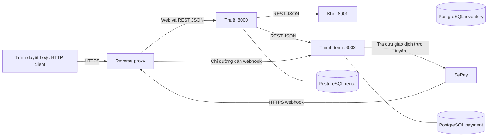
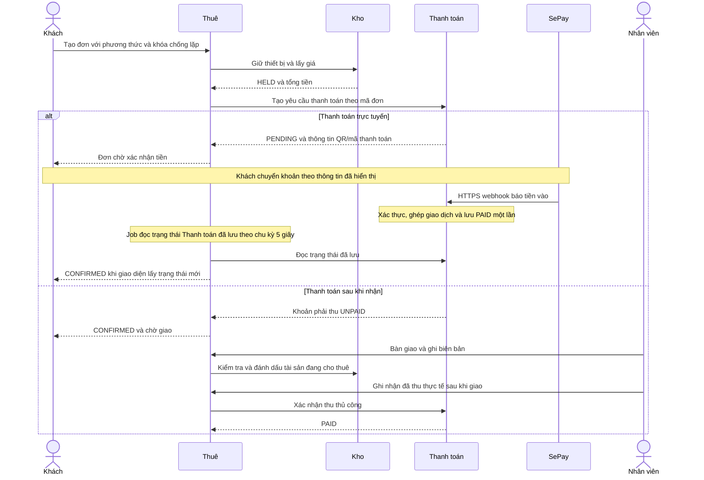
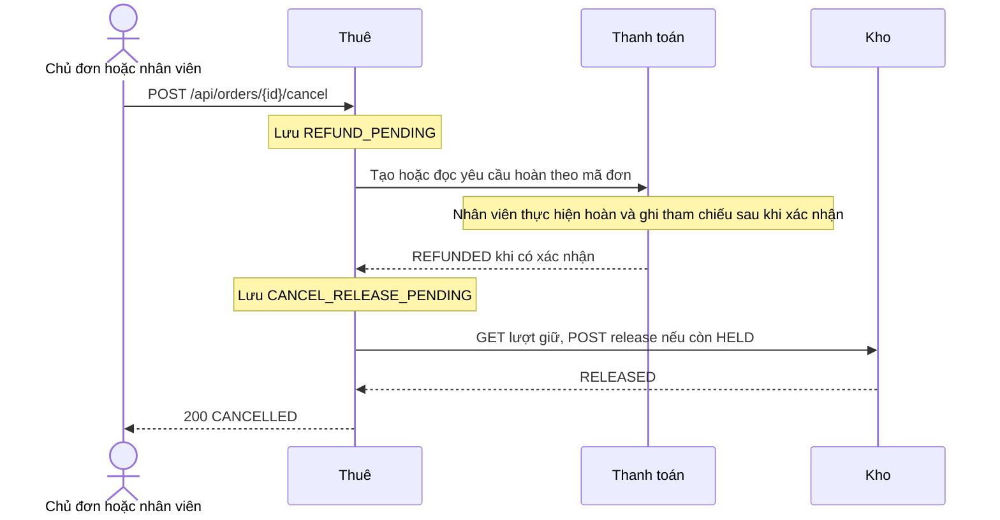

# Kiến trúc và hợp đồng API

Thiết kế đích cho web thử nghiệm và vận hành thật dùng REST/JSON và PostgreSQL. Các cổng dịch vụ bên dưới thuộc mạng nội bộ.

## 1. Ba dịch vụ nghiệp vụ



| Dịch vụ | Trách nhiệm và dữ liệu sở hữu | Bên sử dụng |
|---|---|---|
| **Thuê** | Sở hữu tài khoản, phiên, vai trò và mật khẩu băm, lịch thuê, hạn trả, thời điểm bàn giao/trả thực tế, biên bản và lịch sử. Đơn thuê tham chiếu mã tài sản đã giao và trạng thái thanh toán qua API. | Web và client kiểm thử. |
| **Kho** | Sở hữu loại thiết bị và đơn giá, từng tài sản có mã, lịch giữ theo tài sản, tình trạng vật lý, danh sách phụ kiện và lịch sử bảo trì. | Thuê gọi khi tra cứu, giữ lịch, hủy, bàn giao, nhận trả và mở lại sau bảo trì. |
| **Thanh toán** | Sở hữu yêu cầu thanh toán, khoản phải thu, lịch sử thu/hoàn, sự kiện webhook và mã giao dịch ngoài. Nhánh trực tuyến dùng SePay hoặc bộ mô phỏng tùy môi trường. Nhánh sau khi nhận lưu xác nhận thu của nhân viên. | Thuê gọi khi đặt, hủy, đối soát hoặc ghi nhận đã thu. SePay gọi webhook của Thanh toán. |

Ba dịch vụ chạy riêng. Mỗi môi trường có một cụm PostgreSQL với ba database `rental`, `inventory`, `payment`, mỗi database có role ứng dụng và role migration riêng. Dịch vụ chỉ truy cập database của mình. Mã đơn truyền qua HTTP để tham chiếu giữa dịch vụ, khóa ngoại chỉ nằm trong cùng database. Web và API đi qua cùng origin HTTPS.

Ba trạng thái được theo dõi riêng. Lịch thuê cho biết đã xác nhận, đang sử dụng hay đã trả. Kho cho biết tài sản có mặt và dùng được, còn ở khách, đang bảo trì hay đã xác nhận mất. Thanh toán cho biết khoản thuê đang chờ, đã thu hay đã hoàn. Khi quá hạn mà tài sản vẫn ngoài kho, màn hình lịch thuê hiện cảnh báo. `RETURNED` ghi nhận đã nhận đủ thiết bị, còn khoản phải thu có thể vẫn mở.

## 2. Tương tác đặt thuê và thanh toán



## 3. Tương tác hủy đơn trực tuyến đã thanh toán



Với đơn thanh toán sau khi nhận và chưa bàn giao, Thuê yêu cầu Thanh toán đóng khoản phải thu, rồi trả giữ tại Kho. Phương án hoàn thủ công là lựa chọn phạm vi cho đồ án. Việc nhận webhook tiền vào không tự thực hiện chuyển tiền hoàn.

## 4. API công khai của Thuê

JSON UTF-8. `POST /api/register`, `POST /api/login` và `GET /api/equipment` công khai, không cần đăng nhập. Các đường dẫn còn lại trong bảng cần `Authorization: Bearer <token>`. Thời điểm nhận và hạn trả truyền dưới dạng ISO 8601 có múi giờ.

| Phương thức và đường dẫn | Đầu vào | Kết quả |
|---|---|---|
| `POST /api/register` | Công khai. `username` và `password` (12–128 ký tự). | `201` với hồ sơ CUSTOMER. Trùng tên đã chuẩn hóa trả `409 USERNAME_TAKEN`. |
| `POST /api/login` | Công khai. `username`, `password`. | `200` với `token`, `username`, `role`, `expires_in` (giây) và `must_change_password`. Phản hồi `Cache-Control: no-store`. |
| `GET /api/me` | Bearer token còn hiệu lực. | `200` với tên, vai trò và cờ đổi mật khẩu. |
| `POST /api/logout` | Bearer token đang dùng, kể cả phiên đổi mật khẩu tạm. | `204`, thu hồi phiên. |
| `POST /api/account/change-password` | Bearer token, `current_password`, `new_password`. | `204`, cập nhật mật khẩu, thu hồi toàn bộ phiên và yêu cầu đăng nhập lại. |
| `POST /api/users` | Nhân viên. `username` và `Idempotency-Key`. | `201`, cấp tài khoản `CUSTOMER` và mật khẩu tạm một lần. Gửi lặp không cấp tài khoản hoặc mật khẩu mới. |
| `POST /api/users/{user_id}/reset-password` | Nhân viên, chỉ tài khoản `CUSTOMER`, `Idempotency-Key`. | `200`, cấp mật khẩu tạm một lần và thu hồi phiên cũ. Gửi lặp không đặt lại lần hai. |
| `GET /api/equipment` | Công khai. Query `pickup_at`, `due_at`. | `200` với `equipment[]`, mỗi dòng có mã loại, tên, giá thuê theo ngày và số lượng dự kiến khả dụng trong kỳ. |
| `POST /api/orders` | Phiên khách, `Idempotency-Key`, `pickup_at`, `due_at`, danh sách loại thiết bị và số lượng, `payment_method` (`ONLINE` hoặc `PAY_ON_RECEIPT`). | Trả đơn thuê, trạng thái và hướng dẫn QR/mã nếu chọn trực tuyến. Thiếu khả dụng trả `409 ASSET_UNAVAILABLE`. Trường `simulation_scenario` tùy chọn chỉ ở local/test, theo §11. |
| `GET /api/orders` | Phiên khách/nhân viên. Nhân viên có thể lọc lịch nhận, lịch trả và lượt quá hạn. | `200` với `orders[]`. |
| `GET /api/orders/{id}` | Quyền xem đơn. | `200` với đơn và `history[]`. |
| `POST /api/orders/{id}/reconcile` | Quyền xem đơn. | `200` khi đã có kết quả, `202` nếu còn chờ. |
| `POST /api/orders/{id}/cancel` | Chủ đơn hoặc nhân viên, `Idempotency-Key`. Nhân viên có thể gửi `reason=NO_SHOW` sau hạn đến nhận. | `200` với `CANCELLED`, `202` nếu còn chờ. |
| `POST /api/orders/{id}/handover` | Nhân viên, đơn trong cửa sổ bàn giao, mã tài sản và tình trạng/phụ kiện đã kiểm tra. | `200` với `HANDED_OVER`, `409` khi tài sản không thể bàn giao, `202` nếu cần đối soát. |
| `POST /api/orders/{id}/record-receipt` | Nhân viên, đơn chọn `PAY_ON_RECEIPT` đã từng bàn giao (kể cả đã hoàn trả hoặc đóng vì mất tài sản) và khoản thực thu khớp số phải thu. | Xác nhận thu một lần. Trả trạng thái đã ghi nếu gửi lại. |
| `POST /api/orders/{id}/return` | Nhân viên, đơn đã bàn giao, kết quả kiểm tra từng tài sản và phụ kiện được hoàn trả trong lần này. | `200` với `RETURNED` hoặc `PARTIALLY_RETURNED` khi bật Could, thời điểm trả thực tế và thời lượng quá hạn nếu có. `202` nếu Kho chưa xác nhận, `409 INCOMPLETE_RETURN` nếu thiếu và chưa bật Could. |
| `GET /api/assets` | Nhân viên. Lọc `type`, `status`, `order_id`, `candidate_for_asset_id`, `page`, `page_size`. Bộ lọc ứng viên thuộc Could. | `200` danh sách phân trang. Khi lọc ứng viên, chỉ trả tài sản cùng loại, có mặt và rảnh trong phần kỳ còn lại. |
| `POST /api/orders/{id}/mark-loss` | Nhân viên, `{operation_id,asset_ids,reason}`. Could. | `200` với trạng thái mới, `202` nếu Kho chưa xác nhận. |
| `POST /api/orders/{id}/confirm-refund` | Nhân viên, `{reference,amount}` và `Idempotency-Key`. | `200` khi đã ghi nhận hoàn, `202` nếu còn chờ. |
| `GET /api/payment-exceptions` | Nhân viên. Lọc `status`, `reason`, phân trang. | `200` danh sách giao dịch lệch, ngoài hạn hoặc không ghép được, có mã ngoại lệ, số tiền, mã giao dịch, lý do và đơn liên quan nếu có. |
| `POST /api/payment-exceptions/{exception_id}/resolve` | Nhân viên, `Idempotency-Key`, `{action,reason,reference?}`. | `200` sau khi ghi `REFUNDED_MANUALLY` (cần tham chiếu) hoặc `UNRELATED` (cần lý do). Không xác nhận đơn từ màn hình này. |
| `POST /api/assets/{asset_id}/complete-maintenance` | Nhân viên, tài sản đang bảo trì, `{inspection_passed,note}`. | `200` với tài sản `AVAILABLE`, `409` nếu chưa đạt. |

Đơn thuê có mã đơn, khách, `pickup_at`, `due_at`, `handed_over_at`, `returned_at`, thiết bị, số tiền thuê, `status` và `payment_status`. Chi tiết trả thêm lịch sử và biên bản đã lập. Các mã HTTP thường gặp gồm `400` dữ liệu sai, `401` phiên/khóa sai hoặc thiếu, `403` vai trò sai, `404` không thấy tài nguyên hoặc không có quyền xem, `409` trạng thái/khóa xung đột và `503` phụ thuộc gián đoạn ở luồng đọc. `202` báo bước đã lưu đang chờ xử lý.

## 5. API liên dịch vụ

Các đường dẫn `/internal/` yêu cầu `X-Internal-Key`. Điểm webhook dùng cơ chế xác thực của SePay. Ba dịch vụ có `GET /health` để kiểm tra tiến trình HTTP đã nhận yêu cầu.

| Dịch vụ, phương thức và đường dẫn | Hợp đồng |
|---|---|
| Kho · `GET /internal/equipment` | Cùng query và dữ liệu danh mục với `GET /api/equipment`. |
| Kho · `GET /internal/assets` | Cùng bộ lọc và phân trang như API tài sản công khai. |
| Kho · `GET /internal/holds/{order_id}` | Trả kỳ thuê, giá chốt, trạng thái tổng hợp và trạng thái từng dòng tài sản theo bảng §10. |
| Kho · `POST /internal/holds/{order_id}` | Nhận `pickup_at`, `due_at` và danh sách loại thiết bị. Phân bổ đủ tài sản cho toàn kỳ trong một giao dịch. Trả `409` nếu không đủ khả dụng. |
| Kho · `POST /internal/holds/{order_id}/release` | Giải phóng lịch chưa bàn giao khi hủy hoặc xử lý bù. |
| Kho · `POST /internal/holds/{order_id}/handover` | Xác minh mã tài sản thực tế, kiểm tra lịch và đánh dấu đang cho thuê trong cùng giao dịch. Thiết bị thay thế phải cùng loại và rảnh trong phần kỳ còn lại. |
| Kho · `POST /internal/holds/{order_id}/return` | Ghi kết quả kiểm tra từng tài sản đã hoàn trả và giải phóng phần giữ của các tài sản đó và cập nhật `AVAILABLE` hoặc `MAINTENANCE`. |
| Kho · `POST /internal/holds/{order_id}/mark-loss` | Could. Ghi `LOST` trên dòng giữ và tài sản, theo mã thao tác. |
| Kho · `POST /internal/assets/{asset_id}/complete-maintenance` | Lưu kết quả kiểm tra đạt và mở lại tài sản. |
| Thanh toán · `POST /internal/payments/{order_id}` | Nhận `amount`, `method`, `expires_at` bắt buộc do Thuê tính cho `ONLINE`, và `simulation_scenario` tùy chọn chỉ ở local/test. Cùng mã đơn và dữ liệu trả cùng yêu cầu thanh toán. Thanh toán giữ nguyên `expires_at`. Nếu đã hết hạn, không phát QR và Thuê đi vào luồng đóng/đối soát. `PAY_ON_RECEIPT` không gửi `expires_at` và trả khoản phải thu `UNPAID`. |
| Thanh toán · `GET /internal/payments/{order_id}` | Trả phương thức, số tiền, trạng thái và tham chiếu liên quan. |
| Thanh toán · `POST /internal/payments/{order_id}/reconcile` | Đối soát trực tuyến đang chờ. Dùng tham chiếu/mã và kiểm tra dữ liệu giao dịch SePay. |
| Thanh toán · `POST /internal/payments/{order_id}/record-receipt` | Chỉ dùng cho nhánh sau khi nhận. Thuê gửi số thực thu và định danh nhân viên đã được xác thực. |
| Thanh toán · `POST /internal/payments/{order_id}/cancel` | Đóng khoản phải thu chưa thu hoặc tạo yêu cầu hoàn cho khoản trực tuyến đã thu. |
| Thanh toán · `POST /internal/payments/{order_id}/close-online` | Nhận lý do `CUSTOMER_CANCEL`, `PAYMENT_EXPIRED` hoặc `NO_SHOW`. Đối soát và trả `PAID`, `CLOSED_UNPAID` hoặc `CLOSE_PENDING`. Việc ghi giao dịch, đóng yêu cầu và phát hiện tiền đến sau khi đóng dùng cùng khóa theo mã thanh toán. |
| Thanh toán · `POST /internal/payments/{order_id}/confirm-refund` | Ghi nhận đã hoàn, kèm tham chiếu và nhân viên xác nhận. |
| Thanh toán · `POST /webhooks/sepay` | Điểm HTTPS dành cho SePay. Xác thực webhook, kiểm tra giao dịch tiền vào, mã đơn, số tiền, tài khoản nhận và chống trùng theo ID giao dịch. |
| Thanh toán · `GET /internal/payment-exceptions` | Trả danh sách phân trang và bộ lọc giống API công khai. |
| Thanh toán · `POST /internal/payment-exceptions/{exception_id}/resolve` | Lưu quyết định, người xử lý, thời gian, lý do và tham chiếu. Chống lặp theo khóa thao tác. |

## 6. Khôi phục và phạm vi vận hành

| Tình huống | Phục hồi và bằng chứng |
|---|---|
| Tranh thiết bị cuối | Kho tuần tự hóa giao dịch ghi. Đơn thua ghi `REJECTED` và Thanh toán không có khoản thu cho đơn đó. |
| Lượt trước trả muộn hoặc thiết bị trả về bị hỏng | Lịch tiếp theo vẫn giữ để nhân viên xử lý. Chỉ khi bật Could, nhân viên mới chọn ứng viên cùng loại và Kho kiểm tra lại. Nếu thiếu, trả `409 ASSET_UNAVAILABLE`, lưu `HANDOVER_BLOCKED`, giữ lịch chưa giao và cho phép hủy/hoàn. |
| Mất phản hồi khi bàn giao hoặc nhận trả | Thuê lưu bước chờ và đọc trạng thái lượt giữ tại Kho trước khi thử lại. Kho nhận lặp theo mã đơn và thao tác, trả lại kết quả đã ghi nếu biên bản trùng. |
| Gửi lặp hoặc gửi đồng thời cùng khóa | Thuê lưu một đơn cho cùng cặp khách/khóa. Các dịch vụ đích khóa theo định danh của thao tác. Trạng thái giữ và số bản ghi giao dịch có thể kiểm tra trực tiếp. |
| Thu bị từ chối sau khi giữ | Thuê ghi bước trả kho trước khi gọi trả. Nếu kho gián đoạn, đối soát tiếp khi kho chạy lại. |
| Webhook chậm, gửi lặp hoặc thất lạc | Giữ trạng thái chờ, không suy ra thất bại từ thời gian chờ. Lưu ID giao dịch duy nhất, xác thực rồi ghép với đúng yêu cầu. Dùng API tra cứu SePay khi cần đối soát. |
| Thuê chưa đọc được kết quả đã lưu | Job của Thuê thử lại khi dịch vụ phục hồi. Đối soát thủ công dùng cùng hợp đồng đọc. |
| Giao dịch lệch số tiền hoặc đến sau khi đóng đơn | Lưu để nhân viên đối soát. Không tự xác nhận hoặc mở lại đơn. |
| Tiến trình Thuê bị dừng giữa bước | Khởi động lại với cùng thư mục dữ liệu, sau đó đối soát từ trạng thái lưu. Kho và Thanh toán tiếp tục trả kết quả theo khóa cũ. |

API và worker có thể chạy nhiều tiến trình. Cơ chế phối hợp dùng PostgreSQL như §8. Local/staging có dữ liệu mẫu và mô phỏng. Production dùng tài khoản được cấp, dữ liệu bền vững và thông tin xác thực riêng. Xem [kế hoạch vận hành](06-trien-khai-web.md).

Để nhận webhook thật, cần tài khoản nhận đã kết nối với SePay và URL HTTPS mà SePay truy cập được. Chỉ điểm webhook cần công khai cho luồng này. Đã đối chiếu hướng dẫn SePay ngày 10/11/2026. HMAC-SHA256 và API Key là hai chế độ riêng. Nhóm chọn API Key với header `Authorization: Apikey <secret>`. `401` là phản hồi của hệ thống khi thiếu hoặc sai khóa. Trước demo thật, dùng chức năng gửi thử để kiểm chứng cấu hình trên tài khoản đã chọn. Bộ mô phỏng dùng cùng hợp đồng nội bộ để tái hiện thành công, thất bại và chậm phản hồi trên máy cá nhân. [Hướng dẫn webhook SePay](https://docs.sepay.vn/tich-hop-webhooks.html) · [API giao dịch SePay](https://docs.sepay.vn/api-giao-dich.html)

## 7. Cấu trúc thư mục đề xuất

Stack đề xuất tại G0 là Python 3.12, FastAPI/Pydantic, Uvicorn, PostgreSQL với SQLAlchemy 2, psycopg và Alembic, pytest/httpx cho kiểm thử và HTML/CSS/JavaScript cho web. FastAPI sinh OpenAPI cho API chạy; bản nháp [OpenAPI](../contracts/openapi.json) lấy danh sách route từ bảng §4–§5. Chủ hợp đồng rà soát schema trong G0 trước khi viết mã. REST/JSON và job polling đáp ứng thiết kế hiện tại. Queue, gateway và registry chưa có căn cứ bắt buộc trong đề bài đã nhận.

```text
services/
  rental/                  # Đơn thuê, phân quyền và điều phối quy trình
    src/                   # Điểm khởi động, API, nghiệp vụ, truy cập dữ liệu
    db/                    # Schema và migration riêng của Thuê
  inventory/               # Danh mục, giá, lịch giữ và giải phóng kho
    src/
    db/                    # Schema, migration và dữ liệu thiết bị mẫu
  payment/                 # Trực tuyến qua SePay, mô phỏng và ghi nhận thu sau khi giao
    src/
    db/                    # Schema và migration riêng của Thanh toán
web/                       # Giao diện khách thuê và nhân viên
contracts/                 # Đặc tả API công khai và API liên dịch vụ
config/                    # Cấu hình mẫu cho cổng, URL, thời hạn chờ
scripts/                   # Khởi động, khởi tạo dữ liệu, chạy kiểm thử
requests/                  # Tập yêu cầu API để chạy demo trực tiếp
tests/
  integration/             # Kiểm thử quy trình qua API thật
  fixtures/                # Dữ liệu và tài khoản mẫu dùng cho kiểm thử
docs/                      # Phân tích, sơ đồ, hướng dẫn và minh chứng nhóm
data/                      # Dữ liệu chạy cục bộ, sinh khi khởi động
```

Đây là bản đồ vị trí cho các thành phần khi phát triển. Mỗi dịch vụ giữ riêng mã nghiệp vụ và dữ liệu. Nếu cần thư viện `shared/`, giới hạn ở tiện ích kỹ thuật như HTTP, định dạng lỗi và ghi log. Nếu cần unit test theo dịch vụ, đặt gần mã của dịch vụ. Các bài kiểm thử xuyên dịch vụ nằm trong `tests/integration/`.

## 8. Chi tiết hợp đồng và nhất quán

- `POST /api/orders` trả `201` khi tạo và đã có kết quả, `202` nếu còn bước chờ (kèm mã và trạng thái), `200` khi gửi lại cùng khóa và đã có kết quả, `409 IDEMPOTENCY_CONFLICT` nếu nội dung khác. Chuẩn hóa mốc thời gian về UTC trước khi so, chuẩn hóa mã loại theo danh mục, từ chối loại lặp, sắp danh sách theo mã loại và so cả số lượng lẫn phương thức. Khóa duy nhất theo khách và khóa yêu cầu. Lưu UTC, hiển thị `Asia/Ho_Chi_Minh`.
- `GET /api/orders` và `GET /api/assets` dùng `page` mặc định 1, `page_size` mặc định 20, tối đa 100. Kết quả gồm `items`, `page`, `page_size`, `total`. API tài sản giới hạn nhân viên, lọc theo mã loại, trạng thái hoặc đơn thuê để chọn mã bàn giao. Danh mục MVP dùng seed. Thuê sở hữu tài khoản, phiên và vai trò. Khách được tự đăng ký vai trò CUSTOMER. Luồng nhân viên cấp và reset tài khoản qua API thuộc giai đoạn tiếp theo.
- `POST /api/orders/{id}/handover` nhận `{items:[{asset_id, condition, accessories:[{code,quantity}]}], note?}`. `POST /api/orders/{id}/return` nhận `{operation_id, items:[{asset_id, condition, missing_accessory_codes:[]}], note?}`. Mỗi lần hoàn trả có mã thao tác riêng. `condition` là `OK` hoặc `DAMAGED`, riêng bàn giao chỉ nhận `OK`. Hai API trả `{order_id,status,occurred_at,items}`; trả `202` kèm bước chờ khi chưa xác định được. `occurred_at` do Thuê ghi lúc tiếp nhận thao tác, giữ nguyên khi thử lại.
- Thuê kiểm quyền trước khi chuyển thao tác nhân viên ở §4 sang API nội bộ tương ứng ở §5.
- Lỗi dùng `{error:{code,message}}`. Enum `ErrorCode` và bảng `x-http-status-by-code` trong [OpenAPI](../contracts/openapi.json) là nguồn chuẩn cho mã lỗi và HTTP status. Webhook hợp lệ trả `201` với `{success:true}` sau khi lưu. Gửi lặp cũng được xác nhận.
- Thuê lưu mật khẩu băm bằng Argon2id và chỉ lưu hash của Bearer token. Phiên mặc định 30 phút, giao diện giữ token trong bộ nhớ. Phiên dùng mật khẩu tạm chỉ được đổi mật khẩu và đăng xuất. Thuê tra quyền trên từng tài nguyên. Nhân viên cấp hoặc reset tài khoản khách và chuyển mật khẩu tạm qua kênh riêng. Phản hồi chứa mật khẩu tạm chỉ hiển thị một lần và dùng `Cache-Control: no-store`. Retry trả kết quả cũ đã lược mật khẩu. Nếu mất mật khẩu tạm, nhân viên tạo yêu cầu reset mới. Tài khoản nhân viên đầu tiên được cấp bằng lệnh quản trị riêng.
- API đăng nhập, tra cứu, tạo đơn và webhook có giới hạn tần suất theo luồng. Trả `429 RATE_LIMITED` kèm `Retry-After` khi vượt ngưỡng. Webhook có hạn mức riêng, độc lập với API trình duyệt. Không ghi mật khẩu, token, QR payload đầy đủ hoặc bí mật webhook vào log.
- Kho là nguồn giá đã chốt. Thuê lấy số tiền trực tiếp từ lượt giữ rồi gửi Thanh toán qua API nội bộ. Thanh toán tin Thuê trong MVP, lưu bản sao số tiền và kiểm tra số tiền webhook với bản sao đó. Chỉ môi trường local/test cấu hình bộ mô phỏng và fixture riêng; cấu hình thật từ chối trường mô phỏng, không cho client chọn nhà cung cấp.
- Thuê dùng `SELECT ... FOR UPDATE` trên dòng đơn (dòng khách khi tạo đơn), cùng khóa duy nhất cho yêu cầu lặp. Ghi bước chờ và công việc trong transaction ngắn, commit trước HTTP. Worker nhận công việc bằng `FOR UPDATE SKIP LOCKED` và lease có hạn, thực thi ngoài transaction. Khi lease hết hoặc tiến trình dừng, worker kế tiếp tra cứu trước khi thử lại với cùng khóa. Chỉ cập nhật kết quả nếu token lease và trạng thái kỳ vọng còn khớp.
- Lịch thuê mô tả cam kết với khách. Lịch giữ phân bổ tài sản vật lý theo mã đơn. `CONFIRMED` cần lượt giữ `HELD`. Nếu phát hiện `CONFIRMED` với `RELEASED`, chặn giao, ghi sai lệch và để nhân viên giữ lại lịch qua kiểm tra mới hoặc hủy/hoàn. Trong chuyển tiếp hủy, trạng thái chờ đã ghi trước khi giải phóng lịch.
- SePay chỉ gọi Thanh toán. Thuê đọc trạng thái nội bộ mỗi 5 giây với đơn trực tuyến đang chờ; vòng quét hết hạn QR chạy mỗi phút; quét no-show là Could. Khi webhook chưa đến, đối soát SePay theo chính sách tại mốc đóng, có backoff khi lỗi. Hai dịch vụ không gọi ngược nhau; giao diện lấy trạng thái từ Thuê.
- Khóa dòng đơn và kiểm tra trạng thái kỳ vọng bảo vệ cạnh tranh giữa no-show thủ công của nhân viên (Must), job no-show (khi bật Could), thao tác hủy và bàn giao. Sau khi lấy khóa, bàn giao chỉ hợp lệ trong khoảng `[pickup_at, hạn đến nhận)`. Trước `pickup_at` trả `409 HANDOVER_TOO_EARLY`, từ hạn đến nhận trả `409 HANDOVER_WINDOW_CLOSED`. No-show trước hạn đến nhận trả `409 NO_SHOW_TOO_EARLY`. Các lỗi thời gian này không đổi trạng thái hay lịch giữ. Khi Thanh toán xác nhận chưa thu và đã đóng yêu cầu, Thuê mới trả lịch. Giao dịch đến sau đó được lưu để xử lý thủ công.

- Kho dùng `tstzrange` cho cửa sổ giữ gồm đệm 15 phút, `btree_gist` và `EXCLUDE USING gist (asset_id WITH =, reserved_window WITH &&)` chỉ trên dòng giữ đang hoạt động. Khóa các dòng tài sản theo thứ tự mã khi kiểm tra hiện trạng và ghi toàn bộ bộ thiết bị. Xung đột trả `409 ASSET_UNAVAILABLE` sau rollback. [Ràng buộc khoảng thời gian PostgreSQL](https://www.postgresql.org/docs/current/rangetypes.html#RANGETYPES-CONSTRAINT)

## 9. Điểm mở rộng khi có yêu cầu

MVP hoàn toàn bộ khoản đã thu khi hủy trước bàn giao. Phí hủy là phần mở rộng cần quy định riêng về thời điểm áp dụng, mức phí và số tiền hoàn.

Tiền cọc là khoản riêng với tiền thuê, có vòng thu/hoàn riêng. Phụ phí dùng thời điểm trả và biên bản, tạo khoản điều chỉnh trong Thanh toán thay vì đổi khoản thu cũ. Nếu đưa vào phạm vi, cập nhật API hoàn trả để trả tham chiếu khoản phát sinh và bổ sung ca trả muộn, hỏng, thu/hoàn trùng. Gia hạn cần Kho kiểm tra lại xung đột kỳ trước khi Thuê đổi hạn và tính chênh lệch. Giao tận nơi thêm địa chỉ, lịch giao và bằng chứng bàn giao ở Thuê. Ba dịch vụ hiện tại có thể chứa các phần mở rộng này, còn quy tắc giá và hợp đồng API cần chốt lại trước khi thêm.

## 10. Trạng thái và chuyển trạng thái

| Đối tượng | Chuyển trạng thái | Điều kiện và tác động |
|---|---|---|
| Đơn thuê | `HOLD_PENDING` → `PAYMENT_PENDING`, `CONFIRMED` hoặc `REJECTED` | Giữ thành công thì chờ tiền trực tuyến hoặc xác nhận khoản phải thu khi nhận. Không giữ được hoặc mô phỏng từ chối đã xử lý bù thì `REJECTED`. |
| Đơn thuê | `PAYMENT_PENDING` → `CONFIRMED` hoặc `CLOSE_PENDING` | Thuê đọc khoản đã thu hợp lệ. Yêu cầu hủy hoặc hết hạn đi vào bước đóng và đối soát. |
| Đơn thuê | `CLOSE_PENDING` → `CONFIRMED`, `EXPIRED`, `CANCELLED` hoặc `REFUND_PENDING` | Tiền trong hạn có thể xác nhận nếu lý do là hết hạn và lịch còn hiệu lực. Không thu thì đóng `EXPIRED` do hết hạn QR, `CANCELLED` do khách hủy hoặc không đến. Đã thu và phải hủy thì chờ hoàn. |
| Đơn thuê | `CONFIRMED` → `CLOSE_PENDING`, `REFUND_PENDING` hoặc `HANDED_OVER` | Hủy/no-show kiểm tra tiền và lịch; bàn giao chỉ khi đủ toàn bộ tài sản. `NO_SHOW` là lý do đóng, không phải trạng thái. |
| Đơn thuê | `REFUND_PENDING` → `CANCELLED` | Xác nhận hoàn và Kho xác nhận giải phóng giữ. Nếu chưa rõ một bước, lưu bước chờ để phục hồi. |
| Đơn thuê | `HANDED_OVER` → `RETURNED`; Could thêm `PARTIALLY_RETURNED` → `RETURNED` hoặc `CLOSED_WITH_LOSS` | Ghi từng biên bản. Đơn có mất tài sản đóng `CLOSED_WITH_LOSS` sau khi không còn dòng chưa xử lý, kể cả khi xác nhận mất trong lần xử lý đầu tiên. |
| Lượt giữ Kho | `HELD` → `HANDED_OVER` hoặc `RELEASED`; sau bàn giao tổng hợp thành `PARTIALLY_RETURNED`, `RETURNED` hoặc `CLOSED_WITH_LOSS` | Từng dòng có `RESERVED`, `OUT_ON_RENT`, `RETURNED`, `LOST`, `RELEASED`. Tổng hợp còn dòng ngoài kho và có dòng đã xử lý là `PARTIALLY_RETURNED`. Hết dòng ngoài kho thì đóng theo có mất hay không. |
| Tài sản | `AVAILABLE` → `OUT_ON_RENT` → `AVAILABLE`, `MAINTENANCE` hoặc `LOST` | Trả đạt về khả dụng. Hỏng/thiếu phụ kiện vào bảo trì. Chỉ kiểm tra đạt mới mở lại. `LOST` là Could. |
| Khoản thanh toán | `PENDING` → `PAID`, `CLOSE_PENDING`, `CLOSED_UNPAID` hoặc `FAILED`; `UNPAID` → `PAID` hoặc `CLOSED_UNPAID`; `PAID` → `REFUND_PENDING` → `REFUNDED` | `FAILED` chỉ dùng cho mô phỏng. Hủy/hết hạn chưa rõ giữ `CLOSE_PENDING`, đối soát rồi mới đóng hoặc xác nhận đã thu. Ngoại lệ lưu riêng, không đổi đơn tự động. |

`HANDOVER_BLOCKED` là sự kiện hiển thị trên chi tiết đơn cho khách và nhân viên. Với `409 ASSET_UNAVAILABLE` hoặc sai lệch lịch giữ, Thuê lưu sự kiện và mã lý do, đơn vẫn `CONFIRMED` và Kho không giao món nào. Không gửi email/SMS trong phạm vi này. Lỗi nhập liệu hoặc quyền không sinh sự kiện bàn giao bị chặn. Khi bật thay thiết bị, nhân viên chọn từ danh sách ứng viên, Kho kiểm tra lại trong giao dịch bàn giao. Thay khác loại trả `409 ASSET_TYPE_MISMATCH`.

Đệm kiểm tra sau hạn trả là 15 phút, tách với quy tắc quá hạn `now > due_at`. Kiểm tra giờ mở cửa áp cho cả `pickup_at` và `due_at`. Mỗi dòng trả có `asset_returned_at` từ biên bản; quá hạn tính `max(0, asset_returned_at - due_at)` theo tài sản. Với tài sản còn ngoài kho, tính đến thời điểm đọc. `returned_at` trên đơn chỉ ghi khi món cuối được hoàn trả và không có mất; dùng `closed_at` khi đóng, kể cả đóng do mất.

## 11. Hợp đồng ghép giao dịch và mô phỏng

- Thuê chốt `created_at` theo đồng hồ máy chủ cho đơn mới và dùng cùng mốc để kiểm tra `pickup_at >= created_at + 15 phút` đối với `ONLINE`. Lịch quá khứ trả `400 PICKUP_IN_PAST`. Lịch chưa qua nhưng quá gần trả `400 PICKUP_TOO_SOON` trước khi giữ kho. Thuê lưu và truyền `expires_at = min(created_at + 15 phút, pickup_at)` sang Thanh toán. Thử lại cùng khóa dùng hạn cũ. `PAY_ON_RECEIPT` không có điều kiện 15 phút hoặc hạn QR.

- Khoảng hợp lệ tính theo thời điểm giao dịch ngân hàng, từ `payment_created_at` đến `expires_at` (không gồm mốc hết hạn), không dùng giờ nhận webhook. Lưu cả `bank_transaction_at` và `webhook_received_at`. Giao dịch trong hạn nhận sau khi hết hạn nhưng trước khi đóng có thể xác nhận theo §10. Giao dịch ngoài hạn ghi `OUT_OF_WINDOW`; giao dịch nhận sau khi đã đóng ghi `AFTER_CLOSE`, kèm cờ ngoài hạn nếu có. Lệch tiền hoặc thiếu mã/tài khoản ghi ngoại lệ riêng. Nhân viên tra danh sách và ghi cách xử lý qua API ngoại lệ ở §4.
- Mỗi yêu cầu trực tuyến có mã duy nhất theo mẫu `AT` + 10 ký tự chữ hoa/số, ví dụ `AT7Q2M9C4K8X`. Cấu hình SePay nhận tiền tố `AT` và hậu tố 10 ký tự chữ/số. Thanh toán trả `payment_code`, `amount`, `expires_at`, `qr_url`; dựng QR từ ngân hàng, tài khoản nhận, số tiền VND và `des=payment_code`. Chỉ tự ghép khi `code`, hướng tiền vào, tài khoản và số tiền đều khớp. Xác minh ngân hàng đã chọn hỗ trợ mẫu này qua webhook thử trước demo. [Cấu hình mã SePay](https://docs.sepay.vn/cau-hinh-chung.html) · [QR động](https://docs.sepay.vn/tao-qr-code-vietqr-dong.html)
- `simulation_scenario` truyền từ API tạo đơn sang API tạo thanh toán, chỉ dành cho `ONLINE` ở local/test. `success` ghi thu ngay, `failure` ghi từ chối, `slow` ghi giao dịch vào nguồn mô phỏng ngay nhưng trì hoãn công bố trạng thái 20 giây. Đối soát chủ động đọc được giao dịch đã ghi trước khi công bố. Bộ mô phỏng đi qua adapter nội bộ dùng cùng quy tắc chống lặp, không gọi webhook SePay. Cấu hình thật từ chối trường này bằng `400 SIMULATION_DISABLED`.
- Giới hạn một đơn trực tuyến đang giữ lịch và chờ tiền/đóng trên mỗi khách. Lặp đúng khóa trả đơn cũ; khóa mới vượt giới hạn trả `409 ACTIVE_ONLINE_ORDER_LIMIT`. Kiểm tra và ghi dưới cùng transaction Thuê.
- Hủy, bàn giao và xác nhận hoàn yêu cầu `Idempotency-Key`, phạm vi theo đơn và thao tác. Lặp đúng nội dung trả kết quả đã ghi hoặc trạng thái chờ. Lặp sau một lần chặn bàn giao trả lại kết quả chặn; dùng khóa mới khi thử bàn giao lại. Hoàn trả/báo mất dùng `operation_id`, cùng mã khác nội dung trả `409 OPERATION_CONFLICT`. Cùng tham chiếu hoàn không được ghi hai lần. Validation thiếu trường hoặc loại lặp trả `400 VALIDATION_ERROR` hoặc `400 DUPLICATE_EQUIPMENT_TYPE`. Mã tài sản không thuộc lượt và không phải ứng viên hợp lệ trả `409 ASSET_NOT_IN_ORDER`. Phụ thuộc gián đoạn trước khi lưu bước chờ trả `503 DEPENDENCY_UNAVAILABLE`; đã lưu bước chờ trả `202`.
